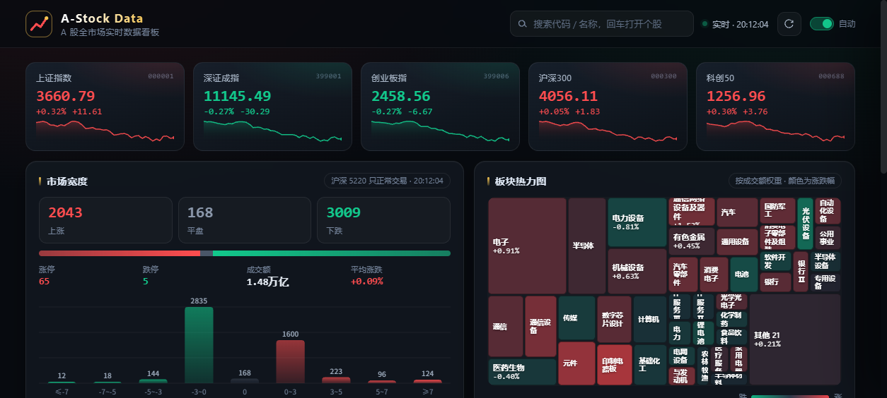

# A-Stock Data

> A 股全市场实时数据看板 · 纯前端 / 零后端 / 免 API Key

一个打开即用的 A 股行情看板：大盘指数、市场宽度与涨跌幅分布、板块热力图、涨跌幅榜、自选股，以及带均线与成交量的个股 K 线。全部由浏览器直接调用公开行情接口完成，**没有任何后端、数据库或密钥**，因此可以直接托管在 GitHub Pages 上。



## 功能

| 模块 | 说明 |
| --- | --- |
| 大盘指数 | 上证、深证成指、创业板指、沪深 300、科创 50，含日内迷你走势与红涨绿跌配色 |
| 市场宽度 | 全市场 5000+ 只个股逐页扫描（并发 + 失败页补抓），统计上涨/下跌/平盘、涨停/跌停、成交额合计、平均涨跌幅，并绘制 9 档涨跌幅分布直方图 |
| 板块热力图 | 东方财富行业板块按成交额加权排布（二叉划分树图），颜色深浅表示涨跌幅，点击查看板块指数走势 |
| 涨跌幅榜 | 涨幅 / 跌幅 TOP 15，点击任意一行打开个股详情 |
| 个股详情 | 最新价、涨跌幅、今开/昨收/最高/最低、成交额、换手率、振幅、量比、市盈率、市净率、总市值/流通市值 |
| K 线图 | Canvas 手绘，日/周/月切换，MA5/MA10/MA20，成交量副图，十字光标 + 悬浮数据提示 |
| 自选股 | 详情页「＋ 自选」收藏，localStorage 本地保存，30 秒自动刷新 |
| 搜索 | 代码或名称模糊匹配，回车直达详情 |

## 数据来源

东方财富公开行情接口（`push2.eastmoney.com` / `push2his.eastmoney.com`），通过 JSONP 调用，无需注册或申请 Key：

- `ulist.np/get` —— 指数、自选股批量快照
- `clist/get` —— 全市场 / 板块列表（每页 100 条，分页拉全量）
- `stock/kline/get` —— 日 / 周 / 月 K 线

> 接口为公开页面所用，稳定性与可用性由数据提供方决定；如遇限流，页面会自动重试并展示已有数据。

## 本地运行

无需构建。任选其一：

```bash
# Python
python -m http.server 8080

# Node
npx serve .
```

然后访问 <http://localhost:8080>。直接双击 `index.html` 也能用（file:// 协议下同样可跨域拉取 JSONP）。

## 部署到 GitHub Pages

```bash
git init -b main
git add .
git commit -m "feat: A股实时数据看板"
gh repo create <你的用户名>/A-stock-Data --public --source=. --push
gh api -X POST repos/<你的用户名>/A-stock-Data/pages \
  -f "source[branch]=main" -f "source[path]=/"
```

一两分钟后访问 `https://<你的用户名>.github.io/A-stock-Data/`。

## 技术说明

- 零依赖：没有 React / Vue / ECharts，图表全部用 Canvas 2D 与 DOM 手写，首屏约 30KB
- `assets/api.js` —— JSONP 封装、分页全量扫描（5 并发 + 失败重试 + 去重）
- `assets/charts.js` —— 迷你走势、分布直方图、树图热力图、K 线（均线 / 成交量 / 十字光标）
- `assets/app.js` —— 状态管理与渲染
- 响应式：≥1240px 三栏、≤1240px 两栏、≤860px 单栏

## 免责声明

本项目仅用于数据分析与前端可视化学习，所有行情数据版权归原始提供方所有，**不构成任何投资建议**。
